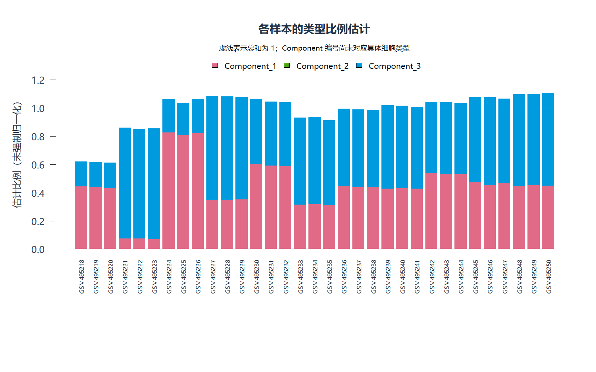
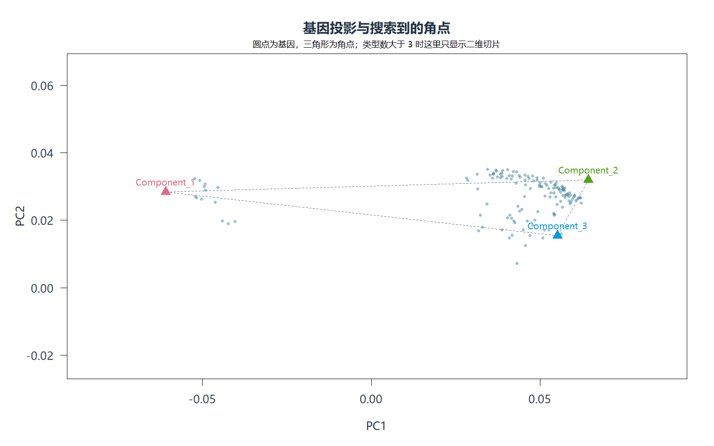
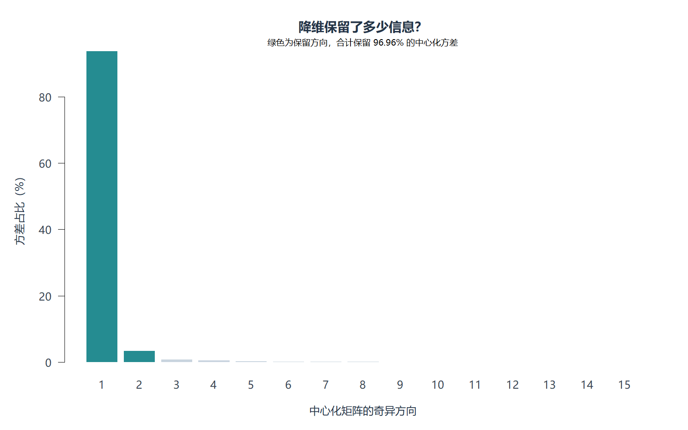
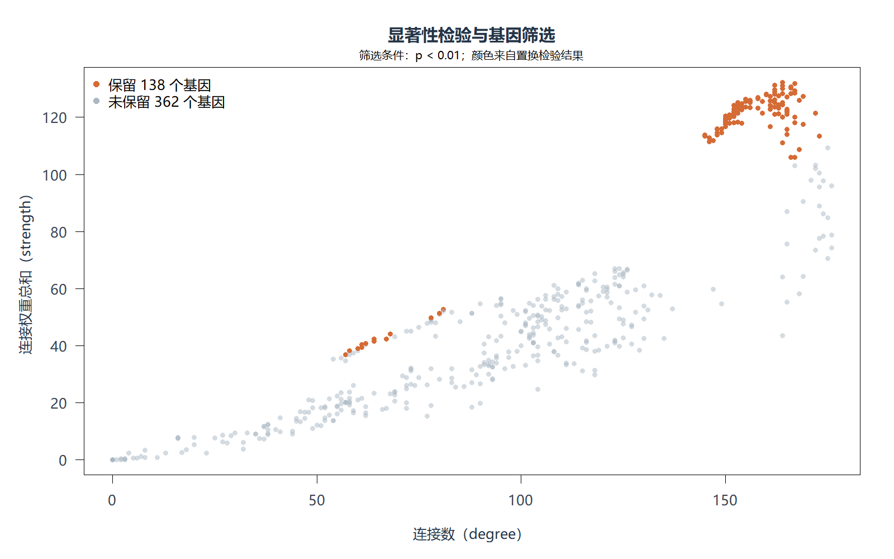

# my_linseed：Linseed 算法学习与分步复现

这是一个用于学习 **bulk 表达数据解卷积** 的 R 项目。参考 [原版 Linseed](https://github.com/ctlab/linseed) 的代码和 quickstart，将流程拆成可以逐步阅读、运行和检查的模块。

目前已跑通读取数据、预处理、基因归一化、基因筛选、降维、角点搜索和解卷积，并生成结果图。**流程跑通不代表比例估计已经可靠**：当前示例仍存在一个成分比例全为 0 的问题，后续需要检查角点与参数。

代码在 AI 辅助下逐步实现和调试，算法思路及部分实现参考原版 Linseed；矩阵分解和非负最小二乘仍调用已有数值工具。本项目不主张算法原创，也不把当前结果等同于论文结果复现。

## 1. 我们在解决什么问题？

bulk 数据测量的是多个细胞成分混合后的表达信号。解卷积希望将表达矩阵近似分解为：

```text
X（基因 × 样本） ≈ S（基因 × 类型） × P（类型 × 样本）
```

- `S`：各类型的基因表达特征。
- `P`：各样本中各类型的比例估计。
- `Component_1` 等只是成分编号，不自动对应具体细胞类型；解释类型需要标记基因或其他参考信息。

## 2. 七步流程与代码对应关系

| 步骤 | 文件 | 主要作用 |
|---|---|---|
| 1. 读取表达矩阵 | `main.R` | 读取官方示例或自己的 CSV；行是基因，列是样本 |
| 2. 预处理 | `R/preprocess.R` | 选择样本、处理表达尺度、去除全零行、选择高表达基因并去重 |
| 3. 按基因归一化 | `R/normalize.R` | 每个基因除以它在所有样本中的总表达量 |
| 4. 关系计算与筛选 | `R/filter_genes.R` | 计算线性关系和 Spearman 相关性，用随机检验筛选基因 |
| 5. 降维投影 | `R/project.R` | 利用 SVD 构造低维表示，为角点搜索做准备 |
| 6. 搜索角点 | `R/find_corners.R` | VCA 初始化、SISAL 优化并比较不同 tau 下的候选角点 |
| 7. 解卷积 | `R/deconvolve.R` | 两次非负最小二乘，估计比例和表达特征 |

`R/plot_results.R` 负责画图，不改变算法结果。

理解归一化时要注意：这里让**每个基因跨样本的总和等于 1**，与让每个样本的总表达量相同不是一回事。投影后每个点代表一个基因在多个样本中的表达变化模式。

## 3. 项目结构

```text
my_linseed/
├── README.md
├── main.R                   # 配置、调用各模块、保存结果
├── R/                       # 算法模块及绘图函数
├── data/                    # 可放自己的输入数据
├── docs/images/             # README 展示的一组结果图
├── results/                 # 实际运行生成的结果目录
└── THIRD_PARTY_LICENSES/
    └── LinSeed-MIT.txt       # 原版代码的许可证和版权声明
```

## 4. 环境与依赖

当前验证环境为 **Windows 11、R 4.5.2、VS Code**。VS Code 用于编辑代码，实际执行代码的是 R。绘图在 Windows 上使用微软雅黑；其他系统的中文字体显示尚未验证。

| 依赖 | 用途 |
|---|---|
| `Matrix` | 稀疏关系网络计算 |
| `corpcor` | 角点初始化中的伪逆 |
| `NMF` | 非负最小二乘求解器 |
| `linseed` | 默认演示所需的 `datasetLiverBrainLung` 数据 |

正式流程不调用 `linseed` 的算法函数；示例数据模式需要安装原版包。依赖包提供的数值算法也参与运算，并不只是安装环境中的占位文件。

可以在 R 中检查依赖：

```r
packages <- c("Matrix", "corpcor", "NMF", "linseed")
sapply(packages, requireNamespace, quietly = TRUE)
```

若缺少前三个包，可使用 `install.packages(c("Matrix", "corpcor", "NMF"))`；原版 `linseed` 的安装方式参见其仓库说明。项目目前没有依赖锁文件，每次运行会保存 `sessionInfo.txt` 记录实际环境。R 的安装目录和整个包库不需要上传到仓库。

## 5. 如何运行

### 先设置本机路径

目前 `main.R` 使用学习电脑上的绝对路径。其他电脑运行前，请修改开头的：

```r
project_dir <- "D:/single cell项目/Linseed/my_linseed"
```

改成自己的项目路径，推荐使用 `/`。脚本还会把项目上级目录的 `library` 加入包搜索路径；若已经把依赖安装到 R 默认包库，可继续使用默认包库。当前尚未实现自动定位项目目录。

### 运行完整流程

在 VS Code 的 **R 终端**中执行以下代码（不是 PowerShell 终端）：

```r
source("D:/single cell项目/Linseed/my_linseed/main.R", encoding = "UTF-8")
```

其他电脑需替换这里的路径。入口中 `run_analysis = TRUE` 且 `stop_after = "full"` 时运行全部七步。完成后可以查看：

```r
analysis$fit$proportions
analysis$fit$signatures
analysis$fit$signatures_linear
analysis$fit$diagnostics
```

`signatures` 是按基因归一化尺度的表达特征，`signatures_linear` 是乘回基因总表达量后的线性尺度特征。

### 分步骤学习

修改 `main.R` 中的 `config$stop_after` 对应配置项：

| 配置值 | 停在何处 |
|---|---|
| `"preprocess"` | 预处理之后 |
| `"normalize"` | 按基因归一化之后 |
| `"filter"` | 基因筛选之后 |
| `"project"` | 降维之后 |
| `"corners"` | 角点搜索之后 |
| `"full"` | 完整解卷积之后 |

每次都会从读取数据开始运行到指定步骤，并保存独立结果目录；不是从上次断点继续。中间步骤返回的对象字段与完整运行不同，例如投影结果查看 `analysis$projection`。

## Dataset：本次分析实际输入了什么？

### 数据来源与研究对象

当前 `main.R` 设置为 `input_source = "demo"`，读取的是 **linseed 包自带的 `datasetLiverBrainLung`**，对应 GSE19830 的肝、脑、肺组织混合表达数据。它是已有的组织混合基准数据，不是本项目新采集的数据，也不是单细胞表达矩阵。这里估计的三个成分应首先理解为组织来源成分，不能直接等同于三个已知单细胞类型。

数据说明依据本地原版包的 `?datasetLiverBrainLung` 文档。数据集编号可在 [GEO：GSE19830](https://www.ncbi.nlm.nih.gov/geo/query/acc.cgi?acc=GSE19830) 查询；当前学习版运行直接读取已安装包中的数据，不会每次从 GEO 下载。

### 输入结构与样本选择

| 项目 | 本次输入 |
|---|---|
| R 对象 | `datasetLiverBrainLung` |
| 完整输入维度 | 13,841 行表达特征 × 42 个样本 |
| 行与列 | 行为基因表达特征，列为样本；行标识保留包中原始标识，不应未经注释就认作标准基因符号 |
| 前 9 列 | 纯组织样本：肺、脑、肝各 3 个 |
| 实际选择 | `samples = 10:42`，只分析 33 个混合样本 |
| 混合样本编号 | GSM495218–GSM495250 |
| 混合设计 | 11 种比例组合，每组 3 个样本 |

本次分析不把前 9 列纯组织表达作为解卷积的参考特征矩阵输入。已知混合比例也不用于拟合，而是可供后续验证。

原版包文档列出的设计如下，列顺序统一为肝、脑、肺：

| 样本编号 | 肝 | 脑 | 肺 |
|---|---:|---:|---:|
| GSM495218–GSM495220 | 5% | 25% | 70% |
| GSM495221–GSM495223 | 70% | 5% | 25% |
| GSM495224–GSM495226 | 25% | 70% | 5% |
| GSM495227–GSM495229 | 70% | 25% | 5% |
| GSM495230–GSM495232 | 45% | 45% | 10% |
| GSM495233–GSM495235 | 55% | 20% | 25% |
| GSM495236–GSM495238 | 50% | 30% | 20% |
| GSM495239–GSM495241 | 55% | 30% | 15% |
| GSM495242–GSM495244 | 50% | 40% | 10% |
| GSM495245–GSM495247 | 60% | 35% | 5% |
| GSM495248–GSM495250 | 65% | 34% | 1% |

这些是实验设计中的组织混合比例，不应直接解释为真实细胞计数比例。比较估计值时还需要匹配成分顺序，不能直接把 `Component_1` 当作肝。

### 数据怎样进入当前算法？

```text
包内表达矩阵：13,841 × 42
    ↓ 选择第 10–42 列
混合样本矩阵：13,841 × 33
    ↓ 去全零行，在对数尺度按行总和排序，取前 500 行并去重
预处理后的线性表达矩阵：500 × 33
    ↓ 每个基因除以该基因在所有样本中的表达总和
按基因归一化矩阵：500 × 33
    ↓ 关系计算与显著性筛选
解卷积输入：138 × 33
    ↓ 投影、角点搜索、非负最小二乘
表达特征 S：138 × 3；比例 P：3 × 33
```

上述维度是当前简化实验的实际记录，不是所有数据运行后的固定维度。输入尺度设置为 `auto`，本次启发式判断结果为 `log2p1`，程序据此用 `2^x - 1` 转回线性尺度。这是**代码采用的尺度解释**，不是对数据上游处理方法的独立验证；不能把包内数值直接称为原始测序 counts。

### 在 R 中查看输入和已知比例

在已配置好包路径的 R 终端中，可单独查看数据，无需运行整个流程：

```r
data("datasetLiverBrainLung", package = "linseed")
dim(datasetLiverBrainLung)
datasetLiverBrainLung[1:5, 10:14]
colnames(datasetLiverBrainLung)[10:42]

data("proportionsLiverBrainLung", package = "linseed")
proportionsLiverBrainLung[, 10:42]  # 用于后续验证，不是算法输入
```

当前虽然配置里有 `input_file = "data/bulk_expression.csv"`，但 **demo 模式不会读取这个 CSV**。只有改成 `input_source = "csv"` 才会使用自己的文件，具体格式见第 9 节。本文没有将尚未提供的个人实验数据描述为已分析数据。

## 6. 参数变动记录：原教程与简化学习版

**为了缩短运行时间，我将原教程的 10,000 个基因改成了 500 个，并缩小了角点搜索范围与迭代次数。这是辅助实现时做出的简化，不是原作者的教程设置，**

| 参数 | 原教程设置 | 当前 `my_linseed/main.R` 与此前简化 quickstart |
|---|---|---|
| 筛选前选取的基因数 | 10,000 | 500 |
| 候选 tau | `2^seq(0, -20, -1)`，21 个 | `2^seq(0, -8, -2)`，5 个 |
| SISAL 迭代次数 | 100 | 30 |
| 样本列 | 10–42 | 10–42 |
| 成分数 | 3 | 3 |
| 随机检验次数 | 100 | 100 |
| p 值筛选阈值 | 0.01 | 0.01 |

缩减基因数会改变参与筛选和角点搜索的数据，并非仅仅让同一个计算更快。当前 500 个基因筛选后剩余 138 个；原教程展示的是从 10,000 个基因筛选到 3,297 个，这个数字属于原文示例，不是本项目重新运行得到的结果。

`study/01_quickstart.R` 使用 `LinseedObject$new("GSE19830", samples=10:42, topGenes=10000)`，并按原文调用 `smartSearchCorners(dataset="filtered", error="norm")`，使用上述默认 tau 与迭代次数。数据入口也恢复为原文的 GEO 数据编号；原文未设置随机种子，脚本不再附加固定种子。保留本机环境路径和结果导出代码，输出位置为上级项目的 `results/quickstart_original/`。

该 quickstart 在 `my_linseed` 文件夹之外。本机可在 R 终端运行：

```r
source("D:/single cell项目/Linseed/study/01_quickstart.R", encoding = "UTF-8")
```

首次读取 GEO 可能需要联网；10,000 基因的两两计算比 500 基因需要更多时间和内存。此次仅完成脚本参数恢复与语法检查，**尚未完成恢复参数后的整套运行**。旧的 `results/quickstart/` 仍是 500 基因的历史结果，不应当作恢复后结果。

本次未修改 `my_linseed/main.R` 的学习版参数。因此，下方图片和数值仍明确属于 **500 基因简化实验**，不能标为原教程完整参数的复现结果。

### 当前学习版参数

默认使用官方包中的 `datasetLiverBrainLung`，选择第 10–42 列，共 33 个样本。

| 参数 | 当前值 |
|---|---|
| 预处理选择的基因数 | 500 |
| 细胞成分数 | 3 |
| 随机检验次数 | 100 |
| p 值筛选阈值 | 严格小于 0.01 |
| Spearman 阈值 | 大于 0 |
| 角点候选 tau | 1、0.25、0.0625、0.015625、0.00390625 |
| SISAL 迭代次数 | 30 |
| 随机种子 | 20261022 |

这些参数用于较快地学习流程，并非论文完整实验参数。100 次随机检验下最小 p 值为 `1/101`，阈值 0.01 非常接近这一分辨率下限，解释筛选结果时需要注意。

## 7. 结果展示与解释

以下图片来自 **500 基因、5 个 tau、30 次 SISAL 迭代的简化学习示例**，不是恢复原教程参数后的结果。它们是固定展示图片；以后重新运行得到的新图保存在对应结果目录的 `plots/` 下。

### 样本比例



每根柱子代表一个样本，不同颜色对应不同成分。虚线为总和 1；图中保留实际估计值，没有强制把各柱子缩放到 100%。当前第二个成分的比例全为 0，所以看不到它对应的绿色区域。

### 基因投影与角点



圆点代表筛选后的基因，三角形代表找到的角点。角点用于描述成分的表达变化方向。图中有部分基因位于角点三角形之外；SISAL 使用软约束，找到三角形本身并不能证明分解正确。

### 降维保留的信息



绿色表示保留的中心化方向。当前前两个方向合计保留约 96.96% 的中心化方差；这不等于细胞比例估计准确率。

### 基因筛选



横轴为基因的连接数，纵轴为连接权重总和；橙色代表通过检验的基因。本次从 500 个基因中保留了 138 个。

### 当前运行的数值结果

| 指标 | 数值 |
|---|---|
| 用于解卷积的矩阵 | 138 个基因 × 33 个样本 |
| 归一化尺度 Frobenius 重建误差 | 约 0.15382 |
| 归一化尺度相对重建误差 | 约 7.14% |
| 线性尺度相对重建误差 | 约 8.26% |
| 各样本比例之和 | 约 0.612–1.104 |

相对重建误差为 `norm(X - S %*% P, "F") / norm(X, "F")`。这些指标描述对表达矩阵的拟合程度，不能代替与真实细胞比例的比较。

## 8. 输出文件

按步骤分布运行，每次向前一步，每次运行在 `results/` 下新建目录，不覆盖旧结果。完整运行主要包括：

- `proportions.csv`：类型 × 样本的比例估计。
- `signatures.csv`、`signatures_linear.csv`：两种尺度的表达特征。
- `reconstructed_normalized.csv`、`reconstructed_linear.csv`：重建矩阵。
- `deconvolution_errors.csv`、`proportion_sums.csv`：重建误差和比例总和。
- 基因筛选、投影和角点相关 CSV：记录中间计算结果。
- `plots/`：四张可直接在 VS Code 中打开的 PNG。
- `analysis.rds`：配置与结果对象；可用 `readRDS()` 重新读取。
- `config.R`、`sessionInfo.txt`：运行参数和环境信息。

重复运行会产生多个结果目录，这是为了保留每次实验记录。展示学习成果时，可以保留一组代表性图表与对应参数，不必把所有重复结果上传。

## 9. 换成自己的数据

CSV 第一列为唯一的基因名，其余列为样本；数值必须有限且非负。例如：

```csv
gene,sample_1,sample_2,sample_3,sample_4
gene_A,10,20,5,8
gene_B,2,8,12,6
gene_C,4,3,9,7
```

以上只展示文件格式，不是足够用于验证算法的真实数据。修改 `config` 中对应项：

```r
input_source = "csv",
input_file = "data/bulk_expression.csv",
samples = NULL,
input_scale = "linear"
```

如果输入明确是 `log2(x + 1)`，设置 `input_scale = "log2p1"`。真实数据应明确表达尺度；`auto` 只是启发式判断。类型数、基因数和检验参数也需依据数据调整。本流程不包含测序质控、批次校正或所有上游表达定量步骤。

## 10. 已做的验证与仍需学习的内容

开发过程中检查了示例上的预处理、归一化和基因筛选与原版的对应结果；投影比较了子空间与重建结果（SVD 坐标符号可以不同）。角点部分对比了相同输入下的 VCA、固定初始化下的 SISAL 以及重建误差计算；解卷积对比了相同角点下原版 `pureDsa` 的输出，并使用已知混合矩阵检查恢复结果。

这些是开发期间的检查记录，当前仓库尚未整理为一套可自动运行的测试。角点候选组合的停止条件做过调整，不能宣称整条流程与原版逐项完全相同。

针对零成分问题的补充对照：原版包在同样的 500 基因简化参数与随机种子下，也出现第二个成分全为 0，重建误差约为 0.15382；保留 500 基因、仅恢复默认角点搜索参数时，仍有一个零成分。原版 README 展示的三种成分则均有非零变化。这说明简化配置下的退化不是绘图遗漏，但尚不能把原因单独归结为基因数；仍需完成原教程参数的对照运行。组分编号也不一定在不同运行之间对应同一种成分。

后续重点：

1. 解释每个模块的输入、输出，以及矩阵维度如何变化。
2. 排查第二个成分比例全为 0 的原因，比较不同初始化、tau、迭代次数和类型数。
3. 使用有真实混合比例的数据验证准确性，而不只看重建误差。
4. 用标记基因解释成分，避免直接给 Component 编号指定细胞名称。
5. 整理可运行测试、固定依赖版本，并改进跨电脑运行时的路径配置。

## 11. Discussion：零成分与比例和偏离 1 的原因分析

本节讨论当前 **500 基因简化实验**：预处理选择 500 个基因，经显著性筛选后，实际用于投影和解卷积的是 138 个基因。结果中 `Component_2` 在所有样本中的比例均为 0，各样本比例之和约为 0.612–1.104。这意味着当前结果不能视为可靠的三组分比例估计。

### 11.1 已确认：零成分产生于角点缩放步骤

找到三个角点后，解卷积首先使用非负最小二乘为每个角点求缩放系数。本次得到：

```text
Component_1：14.72844
Component_2： 0
Component_3：17.66360
```

第二个角点乘以 0 后，其在所有样本中的估计比例都成为 0。因此，角点已经找到，但比例估计没有使用第二个角点；这不是绘图漏画。

作为诊断，取消非负约束时，第二个缩放系数约为 −40.41。非负最小二乘在其自身的约束优化中选择了第二项为 0 的边界解，并非简单地把无约束解中的负数截断。这表明当前角点与非负比例缩放要求之间存在冲突，不能据此推断某种真实组织不存在。示例提供的真实混合比例中，所选样本均包含肝、脑、肺三种组织。

### 11.2 已确认：比例总和只被要求接近 1

记角点矩阵为 `E`（样本 × 类型），缩放系数为 `a`。第一步求解的问题是：

```text
最小化 ||E × a − 1||²，约束 a ≥ 0
P = diag(a) × t(E)
```

这里的 `1` 是每个样本对应一个 1 的向量。因此，`E × a` 正好是各样本的比例总和。目标是让它尽量接近 1，并没有强制它严格等于 1。当前角点下存在拟合残差，故比例总和偏离 1。

零成分和比例和偏离 1 可以同时反映角点估计不理想，但二者不存在必然因果关系：一个成分为 0，并不必然导致其他成分之和不等于 1。

### 11.3 待验证：基因选择与角点搜索的影响

首先，500 个高表达基因经筛选仅剩 138 个。这些基因未必均衡代表三种组织；高表达选择可能遗漏区分某种组织的特异基因，使某个成分的方向难以识别。**这是需要验证的假设，尚不能认定缩减基因数就是唯一或主要原因。**

其次，角点搜索依赖随机初始化，也受到 tau 范围与迭代次数影响，可能得到不理想的解。此前在保留 500 基因的情况下恢复默认角点搜索参数，仍出现零成分，说明这次仅增加搜索范围和迭代次数不足以解决问题。

此外，角点组合按表达矩阵重建误差选择。两个有效成分也可能解释大部分表达变化，所以重建误差较小、投影保留方差较高，都不能证明三种真实比例已被正确恢复。

### 11.4 原版对照提供的证据及其边界

原版包在相同的 500 基因配置和随机种子下，也得到第二个成分全为 0，重建误差同为约 0.15382。这支持该现象不是学习版解卷积函数独有的实现错误，但不能证明整个学习版没有其他问题，也不能代替原教程 10,000 基因设置下的验证。

不同运行的成分编号可能交换；比较时应匹配成分，不能把第二行始终解释成同一种组织。

### 11.5 下一步验证方法

1. 完成原教程参数的基准运行，再固定其他设置比较不同基因数量下的结果。
2. 使用多个随机种子重复实验，观察零成分是否稳定出现，而非只挑选一次较好结果。
3. 同时记录有效成分数、比例和偏离 1 的程度、重建误差，并在匹配成分后与示例真实比例比较。
4. 检查保留基因是否包含足够区分三种组织的表达模式，结合标记基因解释成分。

不应通过给零成分人为加小正数，或仅把剩余比例除以总和，来宣称解决了问题。后者虽然能让柱状图达到 100%，却不能恢复缺失的第三个成分，还可能掩盖当前分解的不足。

## 12. 参考与许可

- 原版项目：[ctlab/linseed](https://github.com/ctlab/linseed)。
- 本地学习参考版本：Linseed 0.99.3，源码提交 `2435a8ceeec90ae7c26e8633a498fd60ace5ff65`。
- 参考实现涉及原版的预处理、关系筛选、投影、VCA/SISAL 角点搜索以及 `pureDsa` 解卷积流程。
- 原版 MIT 许可与版权声明保存在 [THIRD_PARTY_LICENSES/LinSeed-MIT.txt](THIRD_PARTY_LICENSES/LinSeed-MIT.txt)，分享代码时应一并保留。该文件不是运行依赖，也不自动代表整个学习项目已选择同样的许可证。

本项目的学习价值在于逐步拆解、理解和验证算法；文档中的结果和限制均应与实际运行记录一起阅读。
